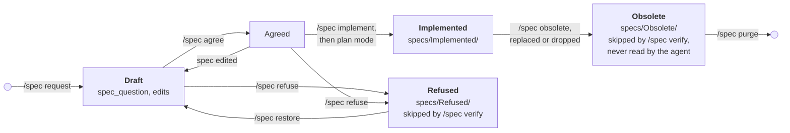
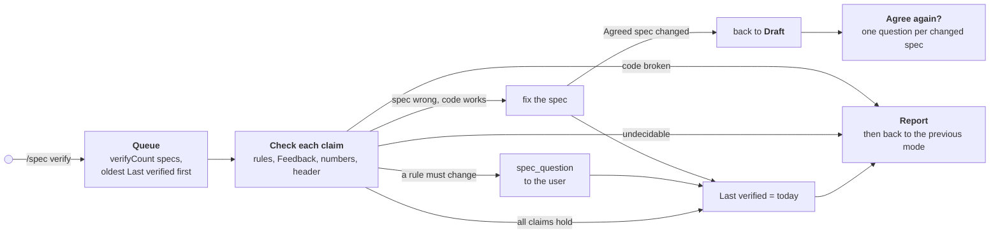

# pi-spec-mode ✎

[](https://www.npmjs.com/package/pi-spec-mode)
[](LICENSE)
[](https://pi.dev)
[](https://nodejs.org)

A [pi](https://pi.dev) extension that adds a **specification mode**: write a feature spec with the agent, agree it, keep it true to the code, and hand it to plan mode to build.

A spec says what a feature is and how it behaves; it never describes code.

## Install

```bash
pi install npm:pi-spec-mode        # or: pi install git:github.com/psychobarge/pi-spec-mode
pi -e ./                           # try a local checkout
```

`/spec implement` also needs [`@narumitw/pi-plan-mode`](https://www.npmjs.com/package/@narumitw/pi-plan-mode). Everything else works without it.

## Use

| Command | What it does |
|---|---|
| `/spec` | Menu of the commands available right now |
| `/spec start` | Enter spec mode |
| `/spec <request>` | Enter spec mode and send the request |
| `/spec list` | List every spec with its status and last check |
| `/spec agree [spec]` | Mark a `Draft` spec `Agreed` (default: the current one) |
| `/spec refuse [spec]` | Mark a spec `Refused` and move it to `specs/Refused/` |
| `/spec restore <spec>` | Bring a refused spec back as `Draft` |
| `/spec obsolete <spec> [replacement]` | Retire an implemented spec to `specs/Obsolete/` |
| `/spec purge` | Delete the obsolete specs (asks first) |
| `/spec verify [spec]` | Check specs against the code |
| `/spec implement <spec>` | Hand an `Agreed` spec to plan mode |
| `/spec template` | Create a spec template fitted to your project |
| `/spec settings` | Show and change the settings |
| `/spec exit` | Leave spec mode |

Commands that take a spec accept its number (`/spec agree 0003`) or file name. Typed without one (`/spec implement`), `agree`, `refuse`, `restore`, `obsolete` and `implement` open the same spec picker as the `/spec` menu; `agree` and `refuse` act on the spec in progress if there is one.

### In spec mode

- The footer shows `✎ spec-mode 0003 · Draft`.
- The agent reads the whole project, runs only read-only shell commands, and writes only Markdown files in the specs folder.
- It asks you decisions through `spec_question`, and calls `spec_complete` when the spec is ready: you then pick **Agree**, **Keep discussing** or **Leave**.
- Before that, it checks the new spec against the existing ones (titles and goals, plus a full read of related `Agreed` / `Implemented` specs) and asks about any contradiction.
- It cannot agree a spec or mark one `Implemented` itself; that stays your call.

### Spec lifecycle

Specs live in `specs/NNNN_spec_<feature>.md`.



- Setting `Status` to `Refused` or `Obsolete` by hand moves the file too.
- A spec number is never reused, even after `/spec purge` (it records the last one in `specs/.last_purged`: commit it).

### Verify

`/spec verify` checks the `verifyCount` specs verified longest ago (or the one you name) and fixes any that drifted from the code. Refused and obsolete specs are skipped.

An `Agreed` spec it had to change goes back to `Draft`; at the end you are asked whether to agree it again (or later, with `/spec agree`).



## Make your own template (do it)

The [bundled template](templates/spec_template.md) is generic on purpose. Good specs come from a template in your project's language: a game needs feel and balance numbers, an API needs contracts and error codes, a mobile app needs screens and offline states. See [a complete spec](examples/0001_spec_dark_mode.md) for the expected level of detail.

```
/spec template
```

The agent copies the generic template to `specs/spec_template.md`, looks at your project, and rewrites it to fit.

**Reread the result.** Every spec is checked against this template when you agree it, so a wrong rule here spreads everywhere. Rename sections, rewrite hints, delete what never applies. After this run the template is yours: the agent only edits it during `/spec template`.

## Settings

Global: `~/.pi/agent/pi-spec-mode.json`. Per project (trusted projects only): `.pi/pi-spec-mode.json`. Edit by hand or with `/spec settings`.

```json
{
  "specsDir": "specs",
  "language": "English",
  "verifyCount": 2,
  "renameSession": false,
  "renamePlanSession": false
}
```

| Key | Meaning |
|---|---|
| `specsDir` | Specs folder, inside the project |
| `language` | Language specs are written in |
| `verifyCount` | Specs checked per `/spec verify` run |
| `renameSession` | Rename the session `spec NNNN creation` when a spec is created |
| `renamePlanSession` | Rename the session `spec NNNN planning` on `/spec implement` |

An invalid value is ignored with a warning and the default is used.

## Develop

```bash
npm install
npm test          # node --test, no build step: pi loads the TypeScript directly
npm run typecheck
```

## Known limitations

- **The conflict check is a model instruction, not code**, and only sees each spec's title and `Goal` section. A conflict hidden in an unrelated-looking spec can be missed; `/spec verify` is the safety net. Keep a `Goal` heading in your template.
- **"Never read an obsolete spec" is a model instruction too.** Run `/spec purge` to be sure.
- **Symlinked specs are ignored**, so nothing is written outside the specs folder.

## Changelog

See [CHANGELOG.md](CHANGELOG.md).

## My other pi extensions & tools

| Extension/tool | What it does | Install |
|---|---|---|
| [pi-deepseek-peak](https://github.com/psychobarge/pi-deepseek-peak) | Shows DeepSeek peak-hour status and corrects session prices | `pi install npm:pi-deepseek-peak` |
| [pi-deepseek-vision](https://github.com/psychobarge/pi-deepseek-vision) | Gives DeepSeek vision through a local or remote vision LLM | `pi install npm:pi-deepseek-vision` |
| [pi-sessions](https://github.com/psychobarge/pi-sessions) | Terminal UI for browsing, previewing, resuming and managing Pi sessions | `pipx install pi-sessions-tui` |

## License

MIT
